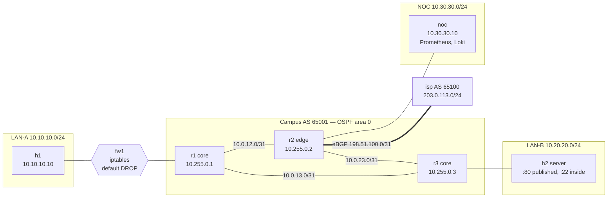

# Network Automation Lab

[](https://github.com/DoctorMen/network-automation-lab/actions/workflows/ci.yml)

**A small enterprise network, defined in one YAML file, built and tested by code.**
Three OSPF core routers, an eBGP uplink to an ISP, a stateful firewall in front of a user LAN, and a server LAN. Every router config, the firewall policy and the lab topology are generated from [`inventory/network.yml`](inventory/network.yml). Then every push to `main`, every pull request and a nightly run deploy the whole network and prove it works: adjacencies come up, routes are where they should be, firewall policy is enforced, traffic survives a link failure (including one where the link stays up and silently drops everything), and no router or firewall has drifted from its intended config.



## What it proves, and the test that proves it

| Behaviour | How it's checked |
|---|---|
| Every core router has Full OSPF adjacencies with exactly the neighbors the inventory says it should | [`test_ospf_adjacencies_are_full`](tests/live/test_routing.py) parses `show ip ospf neighbor json` |
| The eBGP session to the ISP is Established | [`test_bgp_sessions_established`](tests/live/test_routing.py) |
| The ISP only learns the `10.0.0.0/8` aggregate, with no more-specific campus routes leaking out | [`test_isp_sees_only_the_aggregate`](tests/live/test_routing.py) |
| The DDoS lever is lined up: one line on r2 makes the ISP blackhole just the attacked host's /32 (community 65100:666), the rest of the campus still routes, the campus still reaches the host, and removing the line restores it | [`test_rtbh_blackholes_only_the_attacked_host`](tests/live/test_rtbh.py); steps in [`docs/runbooks/ddos-rtbh.md`](docs/runbooks/ddos-rtbh.md) |
| The edge router hands a default route to the core through OSPF | [`test_default_route_reaches_core_via_ospf`](tests/live/test_routing.py) |
| The server LAN is advertised into OSPF, but the router interface facing it is passive, so no OSPF hello reaches a host. Every other core router has an OSPF route to it | [`test_host_lans_are_passive`](tests/live/test_routing.py), for every router interface the inventory puts on a host LAN |
| No routing daemon's management port (vty) answers on a lab link. Every TCP listener on every router is bound to 127.0.0.1, except BGP itself and the NOC's two exporters, on the router's own loopback | [`test_router_daemons_listen_on_localhost_only`](tests/live/test_management_plane.py) |
| From the internet side nothing answers but the published web port (h2:80), and from the ISP's peer address r2's BGP port may answer too. A scan of every campus address on 27 TCP management ports (SSH, telnet, HTTP(S), BGP, NETCONF, every FRR vty), from the ISP's peer address and from another internet address, finds h2:80 open and nothing else, except that from the peer's address, which r2's filter admits to BGP, the test also allows r2's BGP port without requiring it. The same scan from inside finds h2's port 22 and r2's BGP answering, so the closure is r2's edge filter | [`test_wan_scan_finds_only_published_ports`](tests/live/test_edge.py) probes every target at once from the isp node with a small connect-scan tool, so the filtered ports cost 3 s in all, not 3 s each |
| Users can reach the web server and the internet | [`test_dataplane.py`](tests/live/test_dataplane.py) |
| The firewall blocks SSH (port 22) from users to servers. The test also proves h2's port 22 answers from the server's own gateway, so the block came from policy, not a dead service. The listener is a stand-in TCP server, not sshd | [`test_firewall_blocks_ssh_to_servers`](tests/live/test_dataplane.py) |
| A forged source address is refused at every edge we own while real traffic through the same edge passes: fw1 drops what a user sends as a server, r3 drops what the server LAN sends as a user (strict reverse-path filter), and r2 drops private source addresses from the internet, even to the published port | [`test_lan_a_cannot_forge_its_source`](tests/live/test_edge.py), [`test_server_lan_cannot_forge_its_source`](tests/live/test_edge.py) and [`test_internet_cannot_forge_a_private_source`](tests/live/test_edge.py) forge the packets with a raw socket and count them at the edge's drop counter and at the far side: all dropped, none arrive |
| LAN-B is a toy payments segment with a scope register: every device has a scope decision, every in-scope one its PCI DSS clause, and the validator refuses a register the topology contradicts. From every out-of-scope device, LAN-B answers TCP only on published ports and pings only where the register records an exception (h1, for monitoring), and each closed probe answers from inside LAN-B, so the block is policy | [`test_out_of_scope_cannot_reach_in_scope`](tests/live/test_scope.py) probes the tuples generated from the register, TCP services and pings; [`tests/test_scope.py`](tests/test_scope.py) |
| The firewall is stateful: a forged TCP ACK from the server LAN, for a connection no user opened, is dropped instead of being let in as return traffic | [`test_unsolicited_inbound_ack_is_dropped`](tests/live/test_controls.py) forges the packet with a raw socket and reads fw1's exact counters before and after: default drop +1, every allow rule +0 |
| The web rule only lets a connection start: a forged mid-stream ACK to port 80 is dropped, while a real HTTP GET still works | [`test_allow_web_requires_a_handshake`](tests/live/test_controls.py) |
| Anything the rule list doesn't allow is dropped. The test starts a listener on an unlisted port and proves the server's own gateway can reach it, so the block came from policy, not a dead listener | [`test_default_drop_blocks_unlisted_port`](tests/live/test_controls.py) |
| Pulling the r1–r3 link makes OSPF reroute through r2 with no manual action, then fail back | [`test_traffic_survives_r1_r3_link_failure`](tests/live/test_failover.py) |
| Every OSPF link has a BFD session up, with exactly the peers the inventory implies | [`test_bfd_sessions_up`](tests/live/test_failover.py) parses `show bfd peers json` |
| A link that stays up but forwards nothing is routed around in about a second, not after OSPF's 40 s dead timer. h1 still reaches the web server through the stateful firewall, then the path fails back. Measured in the sandbox lab: 0.80–1.20 s with BFD, 35.6–39.7 s without. CI on real Containerlab holds it to 3 s | [`test_silent_failure_reroutes_fast`](tests/live/test_failover.py) drops everything on r1's eth2 with iptables, first proves eth2 is still UP, and fails if the route hasn't moved within 3 s, as happens without BFD |
| No router or firewall differs from its intended config when the check runs. An Ansible playbook backs up every router and the firewall off-box, diffs the running state against intent and fails on any drift. How each device type is collected, and what isn't: [`docs/collection-methods.md`](docs/collection-methods.md) | [`ansible/drift.yml`](ansible/drift.yml) |
| A hand change on a router that was never saved fails one run of that drift check, which names the changed line. The test first proves the check passes on the clean lab | [`test_unsaved_change_is_flagged`](tests/live/test_collection.py) |
| A router backup that is missing part of the running config fails, and the check names the missing line. Each backup is loaded back on its router in test mode; the untouched backup passes | [`test_incomplete_capture_is_flagged`](tests/live/test_collection.py) |
| A rule added by hand on the firewall fails the drift check, which names it. The intended rules are replayed in a separate, empty network namespace, so the check never touches the live rules | [`test_firewall_hand_change_is_flagged`](tests/live/test_collection.py) |
| A hole opened by hand in r2's internet filter, or an anti-spoof rule deleted from r2's or fw1's raw table, fails the drift check, which names each change | [`test_edge_filter_hand_change_is_flagged`](tests/live/test_edge.py) |
| A hand change saved with `write memory` can't overwrite the intended config and hide from that drift check | [`test_write_memory_cannot_overwrite_intent`](tests/live/test_drift.py) |
| A router change goes to the canary (r1) first and must pass a health gate: every OSPF neighbor Full, every BGP session Established, every host answering the other. A change that fails it puts the canary back on the config it ran before, and no other router is touched | [`test_failing_canary_rolls_back_and_blocks`](tests/live/test_rollout.py) takes r1's link to r2 out of OSPF and marks every router. The rollout fails, r1's running config is exactly what it was, and no other router has the mark |
| Nothing changes outside the change window, and a harmless change passes every gate and reaches every router, so the gate doesn't just fail everything | [`test_change_waits_for_window_then_reaches_every_router`](tests/live/test_rollout.py) |
| A patch counts as done only when it runs. `make verify` reports `not in effect` for a kernel installed but not booted into, and for an FRR daemon still running the binary an upgrade replaced on disk, until it restarts. The nodes share the host's kernel, so the test installs a newer kernel's module folder on r2 to stand for the upgrade | [`test_kernel_patch_without_reboot_is_not_in_effect`](tests/live/test_verify.py) and [`test_daemon_patch_without_restart_is_not_in_effect`](tests/live/test_verify.py); [`tests/test_verify.py`](tests/test_verify.py) for the version order |
| h2's QoS is confirmed from its class counters: the installed rates match the inventory, and five connections to port 80 are counted in the web class. That costs a few kilobytes on a 20 Mbit link. A changed rate or a missing filter is `not in effect` | [`test_qos_change_confirmed_from_class_counters`](tests/live/test_verify.py) |
| A backup yields to web traffic. h2's port is capped at 20 Mbit, standing for a link that can't be upgraded, and HTB gives web replies a class of their own. During a 15 MB copy from h2 that fills the link, h1's web p95 stays under 50 ms and every byte arrives. Measured in the sandbox lab: 2.7–6.3 ms, against 110–126 ms on one flat queue of the same rate | [`test_backup_yields_to_web`](tests/live/test_qos.py) runs the copy on a flat queue first and fails if web p95 stays under 50 ms there, since then the copy didn't load the link |
| Every BGP session, OSPF adjacency and BFD peer on a router we own has an alert of its own, which pages while the host still answers ping. The carrier shutting the session, our own end shutting it (Idle (Admin), which a check for state 0 alone misses), an OSPF neighbor whose hellos are dropped, and a BFD peer down while OSPF stays Full each page for that object and no other, within the bound `expected_state.json` states | [`test_bgp_session_down_while_the_peer_pings`](tests/live/observe/test_state.py), [`test_bgp_local_admin_shutdown_alerts_too`](tests/live/observe/test_state.py), [`test_ospf_neighbor_down_while_it_pings`](tests/live/observe/test_state.py) and [`test_bfd_peer_down_while_ospf_and_ping_stay_up`](tests/live/observe/test_state.py) read back what Alertmanager delivered to the NOC's webhook; [`test_one_rule_per_object_the_inventory_implies`](tests/test_monitoring.py) counts the rules from the inventory |
| A web server answering 200 with the wrong page pages, and so does an interface down for 0.3 s between two scrapes, and a newer kernel left unbooted past its reboot window but not inside it | [`test_web_page_with_the_wrong_content_alerts`](tests/live/observe/test_state.py), [`test_sub_second_flap_alerts_although_no_scrape_saw_it_down`](tests/live/observe/test_state.py) (the kernel's carrier-change counter) and [`test_reboot_pending_past_its_window_alerts`](tests/live/observe/test_state.py) |
| Every value a live test, netlab, a playbook or a runbook reads from a device is listed in `monitoring/coverage.yml` for FRR 8.4.1, frr_exporter 1.3.1 and node_exporter 1.8.2: exported to the NOC, derived from what is, or a gap with its fallback. A new read, a scrape job or a rule metric the list doesn't name fails `make test`, and every listed metric and log query answers on the live NOC | `make coverage` ([`netlab/coverage.py`](netlab/coverage.py)) finds the commands in the code's syntax tree; [`tests/test_coverage.py`](tests/test_coverage.py) adds an unlisted read and an unvetted scraper and both fail; [`tests/live/observe/test_coverage.py`](tests/live/observe/test_coverage.py) |
| Every log source has a last-seen check counted where its lines arrive, not by the sender. r1's syslog dropped on the way pages as silent within twice its heartbeat while r1's own counters say it is still sending, and comes back without a restart of anything. `make testevent` sends a marked line from every source the way its real lines go and finds each one in the central store | [`test_blocked_source_raises_source_silent_and_comes_back_without_a_restart`](tests/live/observe/test_arrival.py), [`test_synthetic_event_from_every_source_reaches_the_store`](tests/live/observe/test_arrival.py) and [`test_every_source_has_a_last_seen_check`](tests/live/observe/test_arrival.py) |
| Every router, firewall and server we own logs to one searchable store on the NOC, FRR's routing daemons included, and h2's web server's own log is forwarded by a sidecar running as nobody, with the app unchanged. The store keeps lines the boxes have already rotated away, and no BGP password reaches it | [`test_router_daemons_log_to_the_central_store`](tests/live/observe/test_central_store.py), [`test_app_log_forwarded_without_root_and_searchable`](tests/live/observe/test_central_store.py), [`test_history_outlasts_on_box_rotation`](tests/live/observe/test_central_store.py) and [`test_no_secret_in_the_central_store`](tests/live/observe/test_central_store.py) |
| The NOC's sidecars each run their pinned image (tag and digest) in their node's network namespace, every scrape target answers, every rule the inventory implies is loaded, and noc answers on the campus only on its log sources' two ports | [`tests/live/observe/test_noc.py`](tests/live/observe/test_noc.py) |
| Every alert says why it fired (its condition and the signal's value now), what is normal (the usual value and a link to that signal over the last 7 days) and what changed (the last commit `make apply` applied to that router, and when). Every alert of one live outage, 20 or more not counting the cause markers and the heartbeat, carries all three, filled in by Prometheus | [`test_every_alert_says_why_what_is_normal_and_what_changed`](tests/live/observe/test_outage.py) reads every alert of a live outage from Alertmanager; [`tests/test_alert_context.py`](tests/test_alert_context.py) checks each rule's three annotations read the signal its condition tests |
| A silence covers one object of one alert rule, or one device for at most 4 hours, ends within 7 days, and names who set it, why, and a record. `make silence` refuses a wider or open-ended one and reports a silence added by hand. A silenced flap on one router interface stays quiet while the same flap on another router pages, and pages again once the silence has ended | [`test_a_silenced_flap_still_pages_on_another_router_and_after_the_silence_ends`](tests/live/observe/test_silence.py); [`tests/test_silence.py`](tests/test_silence.py) for `make silence`'s checks on `monitoring/silences.yml` |
| A router cut off from every link pages once, NodeDown, while the alerts that follow from it (its own exporters, its neighbors' sessions with it, the devices behind it) are held back in Alertmanager. frr_exporter killed beside a healthy router, and that router's link to fw1 cut, in the same window page once each, and nothing held back pages after all three recover. A link down for 7 s, which a scrape sees but which is too short for LinkDown, pages once, as a flap. What each alert depends on is computed from the inventory's graph of devices and links | [`test_a_parent_failure_pages_once_and_a_killed_service_pages_again`](tests/live/observe/test_outage.py) reads the webhook's pages and Alertmanager's held alerts, and [`test_a_link_down_for_seconds_pages_once_as_a_flap`](tests/live/observe/test_outage.py) the pages of the short outage; [`tests/test_dependencies.py`](tests/test_dependencies.py) checks the graph, one inhibit rule per cause, no loops and the timing margins |
| Each unattended job (drift, backup, restore drill, power drill) reports its success as its last step, and a job whose last success is older than its window pages. The alert path proves itself: a heartbeat alert is mailed every 10 s, and when mail stops arriving AlertPathSilent pages on the webhook, the second channel | [`test_a_job_whose_last_success_is_a_window_old_pages`](tests/live/observe/test_deadman.py) runs `make drift`, and [`test_a_broken_mail_path_pages_on_the_second_channel`](tests/live/observe/test_deadman.py) measures the gaps between heartbeat mails and refuses SMTP on noc; [`tests/test_jobs.py`](tests/test_jobs.py) checks each job's last make line and its window |
| A burst that the averages hide is traced to its queue. 3000 datagrams that leave h2 in under a second (about 10 ms here) overflow the bulk class of h2's HTB: QueueDrops pages for h2 eth1 within its stated bound, the queue's drop count is exactly what was sent and never arrived, and `tc -s class` names the bulk class. Meanwhile h2's 5-minute average stays under 5% of its link, its interface drop counter stays at 0, and the NOC's web check and ping never fail | [`test_a_microburst_the_average_hides_is_traced_to_its_queue`](tests/live/observe/test_loss.py); [`test_queue_drop_rule_for_every_node_with_a_node_exporter`](tests/test_monitoring.py) counts the rules from the inventory |
| A router that answers only 10 of the 50 pings a second it gets is called a rate limit by `make locate`, not loss, while 20% loss injected on the carrier link at the same time is still placed on r2-isp and handed to the carrier | [`test_a_hop_that_rate_limits_pings_is_not_loss_while_real_loss_is_placed`](tests/live/test_locate.py) |
| Every metric the NOC collects says in `monitoring/coverage.yml` what it counts: the unit, counter or gauge, the direction and whether it counts before or after the queue, and for a counter when it wraps and when it resets. A metric without its entry, a counter without its wrap or reset, or an alert rule that reads a counter outside increase(), rate(), irate() or resets() fails `make test`, and each documented type is the one its exporter declares | [`test_every_metric_says_what_it_counts`](tests/test_coverage.py), [`test_a_rule_reading_a_counter_raw_fails`](tests/test_coverage.py) and [`test_each_metric_is_the_type_its_exporter_declares`](tests/live/observe/test_loss.py) |
| A known byte count matches the NOC's counters. 2000 datagrams of 8000 bytes from h1 to the carrier's address show up in r1's receive and r2's transmit counters, as Prometheus stored them, within 5% of the bytes on the wire (0.002% here), while r2's node_exporter restarts in the middle with no reset in the series and no page. Every interface in the lab is a veth pair, so that is the only interface type tested | [`test_a_known_byte_count_matches_the_counters_across_an_exporter_restart`](tests/live/observe/test_loss.py) |
| A queue counter that starts again at zero is flagged, not paged: after h2's HTB is replaced, resets() flags the fall, rate() over it stays at 0, and QueueDrops stays quiet past its bound. A 32-bit wrap is the same fall; no test drives one | [`test_a_reset_queue_counter_is_flagged_and_pages_nobody`](tests/live/observe/test_loss.py) |
| A link failure leaves evidence of the moment. With r3's port to h2 down for one second, the flight recorder on both ends sends a complete state dump (interfaces and their counters, queues, filters, and r3's OSPF, BFD and routes) to the central store within 13 s, taken while the port was still down. `make evidence` copies every node's dump and its own log off the box before a planned reset, and every dump is in the central store too, with no BGP password in any of it | [`test_a_flap_leaves_a_state_dump_in_the_central_store`](tests/live/observe/test_evidence.py), [`test_evidence_before_a_reset_is_kept_off_the_box`](tests/live/observe/test_evidence.py) and [`test_flight_recorder_is_armed_on_a_link_failure_and_only_reads`](tests/test_monitoring.py) |
| After a power cut of the whole lab, the NOC included, the evidence is still there: r2's flight-recorder dump from a link failure just before the cut, and every line r2's own log held from its last five minutes, are in the central store, while r2 has lost its own copy. The store was restarted shortly before the cut, as after an earlier one, and the cut came after its first checkpoint since. A weekly job is set up to run it | [`test_evidence_outlives_a_power_cut`](tests/live/test_power_event.py), run by `make power-drill` in [`drills.yml`](.github/workflows/drills.yml); [`test_the_central_store_keeps_its_data_on_the_lab_host`](tests/test_monitoring.py) |
| The change-record check fails a pull request whose description doesn't say which risks the lab could not cover: that section is missing, empty, still only the template's guidance, or a filler word like `n/a`. Until main is protected, a red check blocks nothing. What the lab can't cover is in [`docs/LAB_PARITY.md`](docs/LAB_PARITY.md) | [`tests/test_change_record.py`](tests/test_change_record.py), for [`.github/workflows/change-record.yml`](.github/workflows/change-record.yml) |
| The r2–isp BGP session uses TCP MD5 on both ends, with a random password (a new one every CI run), and a wrong password on the carrier's end takes the session down | [`test_bgp_session_uses_its_secret_and_a_wrong_one_drops_it`](tests/live/test_secrets.py) |
| While `make apply` puts back a hand change and `make drift` runs, no command line, environment, routing daemons' log (the syslog file on each router, decision 0019), frr-reload log, container log, playbook output, or file in `build/` or `backups/` holds that password in clear, and the session never drops | [`test_no_secret_in_env_argv_logs_or_files`](tests/live/test_secrets.py) samples `/proc/*/cmdline` and `/proc/*/environ` on the runner about 40 times a second (the routers' command lines included), and inside both routers, with their Ansible temp files, about twice a second; [`test_secrets_reach_a_router_only_on_stdin`](tests/test_secrets.py) reads every play, block and task in `ansible/`, and fails every time a secret-store lookup, or a variable built from one in `group_vars`, `vars_files`, `vars` or `set_fact`, is on a command line or in an environment; a registered result is not followed |
| The password is never rendered: `build/` names only the secret's file, the store is 0600 and never overwritten, and backups and drift output show a sha256 tag in its place | [`tests/test_secrets.py`](tests/test_secrets.py) |
| A router with a BGP password that fails its health gate, after a change that doesn't touch its BGP neighbor's address or AS numbers, goes back to the config it ran before with the password untouched: the session never drops, and neither the saved fallback, FRR's log, a command line nor the playbook output holds the password. Every playbook task that reads or reloads a router's config does it through the redacting vtysh | [`test_rollback_keeps_the_bgp_password_and_writes_it_nowhere`](tests/live/test_rollout.py) makes r2 lose an OSPF neighbor; [`test_every_running_config_read_goes_through_the_redacting_vtysh`](tests/test_secrets.py) reads every playbook task |
| A secret staged in a commit is refused by the gitleaks pre-commit hook, and one committed with `--no-verify` and deleted again is still found by the full-history scan CI runs | [`test_staged_secret_is_blocked_at_commit`](tests/test_secrets.py), [`test_history_scan_finds_a_secret_committed_with_no_verify`](tests/test_secrets.py), each on a new repo |
| A file carrying the confidential marker is refused by the pre-push hook. Pushed anyway with `--no-verify`, the CI scan of the pushed history goes red and names it | [`test_marked_file_is_blocked_at_push_and_alerted_by_ci`](tests/test_secrets.py) |
| gitleaks' default rules miss a BGP password in an FRR backup; this repo's rule catches it, and lets the sha256 tag through | [`test_frr_password_rule_catches_what_default_rules_miss`](tests/test_secrets.py) |
| A backup is judged where it lands. `make backup` sends every router's config and the firewall's and edge routers' rules, as `make drift` captured them, to a restic repository, then reads the snapshot back from there: one file per config and ruleset, each with the capture's sha256, and `restic check --read-data` clean. Data rotted at the destination fails the job, although `restic backup` itself exits 0 | [`test_backup_is_verified_at_destination`](tests/live/test_backup.py) lists and dumps the snapshot itself; [`test_corrupt_destination_fails_the_backup`](tests/live/test_backup.py) flips a byte in every data pack and backs up the same configs again |
| A capture holding the BGP password in clear is never backed up: `make backup` names the file and the secret, not its value, and stops before restic runs, and a capture whose secret file is missing is refused too, since nothing could tell. Every file in the snapshot it reads back is searched as well, and in CI the backup runs only after the secret scan of `backups/` has passed | [`test_a_capture_holding_a_password_is_never_sent`](tests/test_backup.py) and [`test_a_secret_at_the_destination_is_named`](tests/test_backup.py); [`test_backup_is_verified_at_destination`](tests/live/test_backup.py) searches every file of a real snapshot for this lab's password |
| A missing or unmounted backup target fails the job loudly and nothing is written: the job never creates a repository, which would hide exactly that. In CI the cache restore is set to fail on a miss | [`test_missing_target_fails_loudly`](tests/live/test_backup.py) points `make backup` at an empty directory standing in for an unmounted mountpoint and at a path that isn't there, then checks both are still empty or absent |
| A capture missing a router is not backed up without it: the job names the router and sends nothing | [`test_missing_router_is_not_skipped`](tests/live/test_backup.py) removes r3 from a copy of the capture and checks no snapshot was added |
| Every router's latest backup boots on a throwaway FRR router with no network, built like the real one from the topology, and `frr-reload.py --test` finds no difference, while the live routers' running configs stay the same. A backup that doesn't load (one that kept `show running-config`'s header) is named. A weekly job is set up to drill against the real destination | [`test_every_router_restores_cleanly`](tests/live/test_restore.py) and [`test_drill_notices_a_bad_backup`](tests/live/test_restore.py), run by `make restore-drill` in [`drills.yml`](.github/workflows/drills.yml) |
| One item comes back on its own: r2's `router bgp` stanza, from one `restic dump` of one file, pasted into a throwaway router that booted empty, in 2.3 to 2.4 s here against a stated limit of 5 minutes. No full restore, and the live lab is not touched | [`test_single_item_restore_within_limit`](tests/live/test_restore.py) |
| The newest backup at the destination is under 36 hours old, so a backup job that has stopped fails the restore drill | [`test_latest_backup_is_recent`](tests/live/test_restore.py) reads the newest snapshot's time from the destination |
| After a whole-lab power cycle every node comes back by itself from its startup config: an unsaved change on r2 is gone and OSPF, BFD and BGP are up; once `make apply` has set the BGP password again (it is in no startup config), h1 reaches the web server through fw1 and nothing has drifted. On the full lab the NOC then scrapes every target and hears every log source again, with nothing firing. Routing was back 10.8 to 20.2 s after the cut over four runs here before the NOC was added, and 73.9 and 83.7 s over two runs of the full lab. That extra minute matches watchfrr's wait before it starts again a daemon that crashed as it started (V-011), which 3 of 5 other full-lab cycles watched here showed. The NOC was settled 147.2 and 185.6 s after the cut. A weekly job is set up to run it | [`test_power_event_recovers_from_startup_config`](tests/live/test_power_event.py), run by `make power-drill` in [`drills.yml`](.github/workflows/drills.yml). The steps for a person: [`docs/runbooks/power-event.md`](docs/runbooks/power-event.md) |
| Loss on the carrier link is placed on the carrier from our side alone. `make locate` clears every campus segment in path order, names `r2-isp` and its owner from the inventory, and our edge router sees the loss directly. We never log into the carrier | [`test_carrier_loss_is_placed_on_the_carrier`](tests/live/test_locate.py) |
| Loss on a campus link is named as ours, and from our edge the carrier is clean | [`test_campus_loss_is_not_blamed_on_the_carrier`](tests/live/test_locate.py) |
| A clean path raises no alarm | [`test_clean_path_raises_no_alarm`](tests/live/test_locate.py) |
| `locate` refuses to run on any device the operator doesn't own, loss at a middle hop that doesn't carry on to the destination (ICMP rate limiting) is not called loss, and a hop that didn't answer traceroute is traced again instead of being skipped, which would hand our segment to the carrier | [`tests/test_locate.py`](tests/test_locate.py) |
| `make finding` sends the carrier a bundle they can re-run: every command's raw output, an ICMP capture on our hand-off port, FRR support bundles, versions, clocks and RFC citations, and no BGP password. Its `reproduce.sh`, run from a copy with only sh and docker, names the same segment and owner, and says it did not reproduce once the loss is gone. A CI job re-runs it on a runner with no checkout; it first passed on GitHub in run 38831606745 (a pull-request run) | [`test_carrier_finding_reproduces_from_the_bundle_alone`](tests/live/test_finding.py); CI job `reproduce` |
| `netlab finding --verify` refuses a bundle with a missing or edited file, an empty support log, no probe in its capture, a missing citation, an image without a digest, or a BGP password, and `reproduce.sh` says Reproduced only when its own run agrees | [`tests/test_finding.py`](tests/test_finding.py) |
| Runbooks for link failure, BGP down, config drift, restoring a router from backup, a power event, carrier loss and a DDoS blackhole at the ISP each name an owner, a coordinator, who updates stakeholders, a review date and their hosts. The check fails on a missing field, a review older than 180 days, or a host that isn't in the inventory or in the runbook's own host list | [`tests/test_runbooks.py`](tests/test_runbooks.py) against [`docs/runbooks/`](docs/runbooks/README.md), with all problems reported at once |
| The inventory can't ship with duplicate IPs, mismatched subnets, overlapping networks, wrong BGP peer addresses, off-subnet gateways or a device with no owner | [`tests/test_inventory.py`](tests/test_inventory.py), with all problems reported at once |
| Every node runs exactly the image (tag and digest), FRR, Alpine and busybox builds the inventory records, and CI pulls that image | [`test_running_version_matches_inventory`](tests/live/test_platform.py) reads `apk info -v` and `/etc/os-release` on all 8 nodes and `show version` on the 4 routers; the NOC's sidecars run images of their own, checked by [`test_sidecars_run_their_pinned_image_in_their_nodes_namespace`](tests/live/observe/test_noc.py); [`test_ci_pulls_the_image_the_inventory_names`](tests/test_render.py) |
| Every odd behaviour in the log has one verdict (my config, normal behaviour, platform bug or lab artifact), the version it was seen on, and a fix or workaround. None may stay unclassified past 5 working days | [`docs/verdicts.yml`](docs/verdicts.yml), linted by [`tests/test_verdicts.py`](tests/test_verdicts.py) |
| Every outside lever (the ISP's blackhole, a source network's abuse desk, a lookalike domain's registrar, the police) has a holder, a contact and the evidence it needs, checked within the last 90 days | [`docs/outside-levers.yml`](docs/outside-levers.yml), linted by [`tests/test_levers.py`](tests/test_levers.py) |
| Every design decision has a record naming the constraint, the alternatives (doing nothing included), an outside source, the stake and who decides | [`docs/decisions/`](docs/decisions/), linted by [`tests/test_decisions.py`](tests/test_decisions.py) |
| FRR, Containerlab, Ansible, iptables, gitleaks, Docker, GitHub Actions, restic, Prometheus with Alertmanager, node_exporter with blackbox_exporter, frr_exporter, Loki and Vector each have a selection record with its constraint, a no-purchase line, staffing, and sources its maker didn't write, a measurement of our own among them. A new image in the inventory, Makefile, hooks or CI fails the check until it has one | [`docs/selections/`](docs/selections/), checked by [`tests/test_selections.py`](tests/test_selections.py) |
| Every risky config line of a kind `make risks` scans for (no eBGP inbound policy, OSPF without authentication, privileged nodes, any ICMP type through fw1, an out-of-support base OS and more) is covered by a risk register entry with likelihood, impact, reasoning, a compensating test or why there is none, an owner and a review date. An entry whose line is gone is flagged to close, and a decision record that accepts a risk must name its entry. None has been presented to management yet | [`docs/risks.yml`](docs/risks.yml), checked by [`tests/test_risks.py`](tests/test_risks.py); `make risks` |
| The RAM figure below is the newest measurement, and that raw data is committed | [`tests/test_sizing.py`](tests/test_sizing.py) against [`docs/sizing/`](docs/sizing/README.md) |
| Every claim in this table, and every fw1 rule, is in a control register with what it defends against, how it fails, the test that proves it and how often that test must pass | [`docs/controls.yml`](docs/controls.yml), linted by [`tests/test_controls.py`](tests/test_controls.py) |
| Every control in the register has its latest test green and inside its period. `make control-status` reads the dated JUnit results of this run and earlier runs on `main`, newest first, and fails naming any control whose latest result is red, missing or too old. A CI job is set up to run it on `main` | `make control-status` in CI ([`netlab/control_status.py`](netlab/control_status.py)), proven on fixture JUnit files by [`tests/test_control_status.py`](tests/test_control_status.py) |

CI runs every test each night as well as on every push to `main` and every pull request; the restore and power-event drills are set to run weekly in their own workflow ([`drills.yml`](.github/workflows/drills.yml)). Every job keeps its JUnit results (offline, review, live, the NOC's observe tests and the drills, each timestamped) as a run artifact for 90 days, except that the lab job and the observe job keep their results, with `backups/`, only when their own secret scan passed. When either scan fails, the control-status job fails too, naming ACC-4, because it would otherwise read an earlier run's results in their place. The four checks that compare a record's date with today run in their own job, which the lab job doesn't wait for, so a review falling due turns that job red without stopping the live tests or the nightly backup. The register says how old the latest pass may be (31 days, 90 for the restore drill), and on `main` a control-status job is set up to fail when a control's latest result is red, missing or older than that.

## Scored against what operators actually need

[OROS 0.3](docs/oros/README.md) is a standard of 61 pass/fail requirements for network and security operations, built from 3,785 relevant Stack Exchange questions and 103 mailing-list, forum and feature-tracker posts. [The scorecard](docs/oros/scorecard.md) holds this lab to every one of them, and names the test behind each pass: **15 pass, 14 partial, 32 fail.** Most of the fails need things a seven-container lab doesn't have yet (a log collector, alerting, per-person accounts), and the scorecard says what each one is missing.

## How it works

```
inventory/network.yml ──► netlab validate ──► netlab render ──► build/
   (source of truth)        (IPAM checks)       (Jinja2)        ├── r1..r3, isp/frr.conf     FRR router configs
                                                                ├── fw1/firewall.sh          iptables policy
                                                                ├── r2, r3/edge.sh           edge filter, anti-spoof
                                                                ├── topology.clab.yml        Containerlab topology
                                                                ├── noc/, monitoring/        the NOC's targets, alert rules, collector
                                                                ├── ansible_inventory.yml    Ansible inventory
                                                                └── expected_state.json      what the tests expect
                                     containerlab deploy ──► pytest tests/live ──► ansible drift.yml
```

- **Routers** run [FRRouting](https://frrouting.org/) 8.4.1. Its CLI is close to Cisco IOS. Why FRR and not a vendor image, BIRD or VyOS, with sources FRR didn't write: [its selection record](docs/selections/frr.md); Containerlab, Ansible, iptables, gitleaks, Docker, GitHub Actions, restic and the NOC's tools have one too, in [`docs/selections/`](docs/selections/). The exact image digest and package versions are in the inventory's `platform:` block, and a live test checks every node against them.
- **The firewall** is a Linux node with an ordered, stateful iptables policy (`ESTABLISHED,RELATED` first, explicit deny, counted default drop) rendered from the rule list in the inventory. The TCP rule (allow-web) carries `syn: true`, rendered as `--syn`, so only a connection's opening packet can match it and the rest must come through as `ESTABLISHED`. allow-internet matches every protocol, so it can't, and a forged outbound ACK still passes it ([the register](docs/controls.yml) says so). `--ctstate NEW` alone isn't enough: with the kernel default `nf_conntrack_tcp_loose=1`, conntrack picks up a forged mid-stream ACK as a NEW connection. The default drop is counted, not logged: the kernel's LOG target writes nothing from inside a container's network namespace unless the host sets `net.netfilter.nf_log_all_netns=1` ([V-006](docs/verdicts.yml)), so the drop rule's packet counter is the record the tests read.
- **The edges** are filtered where we own them ([0012](docs/decisions/0012-wan-edge.md)). Before any FORWARD rule, fw1's raw table drops whatever arrives on the user side from outside the user subnet, so no user can send as a server or as the internet. r2 lets in from the ISP only replies, ping to itself, BGP from the peer's address and the one published port, h2:80, and drops private source addresses first. r3 runs a strict reverse-path filter toward the server LAN. r2's and r3's rules are rendered into an `edge.sh` per router and drift-checked like fw1's.
- **The NOC** (`noc`, on its own LAN behind r2) runs Prometheus, Alertmanager, blackbox_exporter, Loki and a Vector collector as sidecars in its network namespace, and each router we own runs frr_exporter and node_exporter beside it the same way, so no image changes. Every scrape target, alert rule and log source is generated from the inventory into `build/noc/`. Alertmanager delivers each alert to a webhook sink on noc, which the tests read back. CI's lab job deploys the network alone (`make deploy-network`); a second job, in parallel, deploys everything and runs `make observe`. [0018](docs/decisions/0018-noc-state-checks.md), [0019](docs/decisions/0019-central-logs.md)
- **Odd behaviours** each get an entry in [`docs/verdicts.yml`](docs/verdicts.yml): the version, the evidence, one verdict, and the commit that fixed it or the workaround.
- **Ansible** connects to each node through the Docker connection plugin, so no SSH keys are needed in the lab. [`deploy.yml`](ansible/deploy.yml) uses `frr-reload.py` to apply only the lines that differ, without restarting routing daemons. It changes the canary first, gates each batch on the network's health and puts a batch that fails the gate back on the config it ran before. A router that fails an earlier step goes back alone, and the rest of its batch keeps the change. `--check` prints the plan without applying it. After each router's apply it sets the r2–isp BGP password from the secret store through vtysh's stdin, so outside its 0600 secret-store file the password is in no file, log, environment or command line (root on r2 or isp can still read the key, RISK-8). A small vtysh wrapper on each router shows backups and drift a sha256 tag in its place, and leaves the line out of what the apply and the rollback read and save, so a rollback neither deletes nor sets a password, unless the failed change deleted the neighbor itself: then the neighbor comes back without its password and its session stays down until `make apply` runs on the reverted inventory (RISK-30, [0016](docs/decisions/0016-secrets-guardrails.md)).

## Run it yourself

You need Linux (or WSL2 on Windows) with Docker. The lab is small: measured at 358.5 MiB for all 22 nodes in the `sandbox` environment, the 8 network nodes and the NOC's 14 sidecars, of which Loki and Prometheus take a quarter. Before the NOC, the network was measured at 90.5 MiB for all 7 nodes in the `github-runner` environment, a GitHub-hosted runner with real Containerlab ([sizing and raw data](docs/sizing/README.md)).

```bash
git clone https://github.com/DoctorMen/network-automation-lab && cd network-automation-lab
python3 -m venv .venv && . .venv/bin/activate
pip install -r requirements.txt -r requirements-ansible.txt
pre-commit install   # gitleaks hooks: a secret is refused at commit, a confidential file at push
bash -c "$(curl -sL https://get.containerlab.dev)"   # installs Containerlab

make test      # offline: inventory, rendering, locate rules, control register and record lints, scorecard (134 tests)
make review    # the dated reviews: a verdict to classify, or a lever, risk or runbook due for review (4 tests)
make deploy    # render configs, make this lab's BGP password, start 8 nodes and the NOC's 15 sidecars, set the password
make live      # 47 live tests against the running network, JUnit in results/live.xml
make observe   # the NOC's tests (tests/live/observe): each break pages, each log source arrives
make testevent # a marked line from every log source, found in the central store
make evidence  # before a planned reset: every node's state dump and own log, into results/evidence/ and the central store
make logs NODE=r2 MINUTES=15   # a node's last lines from the central store, also after it was reset
make drift     # back up routers and firewall, fail on drift or an incomplete backup
make verify    # is each change in effect, not just installed: kernels, FRR daemons, h2's QoS
make backup-init   # once, by hand: create the backup destination, BACKUP_REPO (default /mnt/backup/netlab-restic)
make backup        # send that backup to BACKUP_REPO and verify it there; fails if the target isn't mounted
make restore-drill # boot every router's latest backup on throwaway routers, and restore one stanza alone
make power-drill   # power-cycle the whole lab and check it comes back by itself
make measure LAB_ENV=laptop   # RAM per node, saved to docs/sizing/data/
make finding SRC=h1 DST=203.0.113.1   # locate loss and write a bundle the carrier can re-run, in results/finding/
make risks     # the risk register, with the config lines each risk accepts
make gitleaks  # scan every commit, then backups/, results/ and build/, for secrets
make destroy
```

Poke at it like a real network:

```bash
docker exec -it clab-netauto-r2 vtysh          # then: show ip ospf neighbor / show bgp summary / show ip route
docker exec clab-netauto-h1 ping 10.20.20.10
docker exec clab-netauto-fw1 iptables -vnL FORWARD
```

### Try breaking it

- Open a hole in r2's internet filter (`docker exec clab-netauto-r2 iptables -I FORWARD -i eth3 -p tcp --dport 22 -j ACCEPT`) and run `make drift`. It fails and names the rule; the same command with `-D` removes it.
- Pull the DDoS lever: `docker exec clab-netauto-r2 vtysh -c 'conf t' -c 'ip route 10.20.20.10/32 10.20.20.1 tag 666'`, then `docker exec clab-netauto-isp ip route show 10.20.20.10` says `blackhole`. `make drift` names the trigger until you remove it with `no` in front ([runbook](docs/runbooks/ddos-rtbh.md)).
- Change an IP in `inventory/network.yml` so a link's two ends are in different subnets, then run `make validate`.
- Make an undocumented change on a router (`vtysh -c 'conf t' -c 'router ospf' -c 'passive-interface eth2'`) and run `make drift`. It fails and shows the diff. `make apply` puts the router back.
- Open SSH on the firewall by hand (`docker exec clab-netauto-fw1 iptables -I FORWARD -p tcp --dport 22 -j ACCEPT`) and run `make drift`. It fails and names the rule. Delete it with the same command and `-D` instead of `-I`.
- Take a link down (`docker exec clab-netauto-r1 ip link set eth2 down`) and watch `show ip route 10.20.20.0/24` on r1 move to the path through r2.
- Make the same link fail silently: `docker exec clab-netauto-r1 iptables -I INPUT -i eth2 -j DROP`, then the same with `-I OUTPUT -o eth2`. The link stays up, but in about a second BFD declares r3 down, OSPF drops that neighbor (`show ip ospf neighbor`) and the route moves to r2. Run both again with `-D` instead of `-I` to put it back.
- Make the carrier lossy (`docker exec clab-netauto-isp iptables -I INPUT -i eth1 -p icmp -m statistic --mode random --probability 0.2 -j DROP`) and run `make locate SRC=h1 DST=203.0.113.1`. It clears each campus segment, names `r2-isp` and the carrier NOC, and writes the evidence to `build/finding.json`. The same command with `-D` removes the loss. The steps and what to send the carrier are in [`docs/runbooks/carrier-loss.md`](docs/runbooks/carrier-loss.md).
- With the carrier still lossy, run `make finding SRC=h1 DST=203.0.113.1`, copy `results/finding/` anywhere outside the repo and run `sh reproduce.sh` in the copy. It ends with `Reproduced: loss starts on r2-isp`. Remove the loss and run it again: `Did not reproduce`.
- Give the carrier's end a BGP password that doesn't match: `docker exec -i clab-netauto-isp vtysh -f /dev/stdin`, then type `router bgp 65100` and a `neighbor 198.51.100.0 password` line with any other word. r2's session drops and stays down. `make apply` puts the right one back.
- Forge a mid-stream ACK from the server to a user (`docker exec -i clab-netauto-h2 python3 - 10.10.10.10 20000 80 < tests/live/tools/forge_ack.py`) and watch `default-drop` count it in `docker exec clab-netauto-fw1 iptables -vnxL FORWARD`.
- Give r1 the wrong OSPF area (`ospf: { area: 1 }` under `r1:` in the inventory), then `make render` and `make apply`. r1 loses both neighbors, fails the health gate and goes back to the config it ran before; r2, r3 and isp are never touched. `make drift` names r1 until you put the area back and `make render` again.
- Delete h2's web filter (`docker exec clab-netauto-h2 tc filter del dev eth1 parent 1:`) and run `make verify`: h2's QoS is `not in effect`, because the probe's connections landed in the bulk class. `docker exec clab-netauto-h2 tc filter add dev eth1 parent 1: protocol ip prio 1 u32 match ip sport 80 0xffff flowid 1:10` puts it back.
- Point the backup at a target that isn't mounted (`mkdir -p /tmp/not-mounted && make backup BACKUP_REPO=/tmp/not-mounted`). It fails, says the target is not mounted or was never created, and `/tmp/not-mounted` is still empty. How backups and restores work: [`docs/backups.md`](docs/backups.md). The runbooks for the faults above are in [`docs/runbooks/`](docs/runbooks/README.md).
- Change `frr:` in the inventory's `platform:` block to `8.4.2_git-r0`, then run `make render` and `make live`. `test_running_version_matches_inventory` names every node that runs something else.

## Sample output

From a real run:

```
r2# show ip ospf neighbor
Neighbor ID     Pri State           Up Time         Dead Time Address         Interface
10.255.0.1        1 Full/-          40.473s           39.526s 10.0.12.0       eth1:10.0.12.1
10.255.0.3        1 Full/-          35.335s           39.661s 10.0.23.1       eth2:10.0.23.0

isp# show ip bgp
   Network          Next Hop            Metric LocPrf Weight Path
*> 10.0.0.0/8       198.51.100.0             0             0 65001 ?
*> 203.0.113.0/24   0.0.0.0                  0         32768 i
```

## Design decisions

Each decision has a record in [`docs/decisions/`](docs/decisions/) with the constraint behind it, the alternatives (doing nothing included), outside sources, the stake and who decides. `make test` lints them.

- **Point-to-point /31s and `ip ospf network point-to-point`** on router links. No DR/BDR election, faster adjacency (10 s against 40 s for the broadcast default, measured), and half the address space of /30s (RFC 3021). [0001](docs/decisions/0001-p2p-31-links.md)
- **LAN-A sits behind a firewall and is reached by a static route redistributed into OSPF**, not by running OSPF on the firewall. Security devices shouldn't take part in the routing protocol unless they have to. [0002](docs/decisions/0002-static-route-to-lan-a.md)
- **Aggregate at the edge (`summary-only`)**. The ISP sees one stable `/8`, so internal link flaps never reach the internet routing table. [0003](docs/decisions/0003-summary-only-aggregate.md)
- **BFD on every OSPF link, with FRR's default timers** (300 ms, 3 missed packets). OSPF alone needs its 40 s dead timer to notice a link that is up but passes nothing. There is no `bfd` profile, because FRR hides default timer values in `show running-config`, so a profile that spells them out would show as drift forever. Each failure mode of the failover design has a mitigation or an accepted risk in its record. [0009](docs/decisions/0009-failover.md)
- **Router changes go canary first, behind a health gate, with an automatic rollback.** Each router saves its running config before the change; a batch that loses an OSPF neighbor, a BGP session or a host's reachability goes back to it, and the rollout stops. The rescue has to end in a failure, or Ansible counts the router as rescued and carries on. [0010](docs/decisions/0010-canary-rollout.md)
- **A backup yields to web traffic.** h2's port is shaped with HTB: capped at the link's rate, web replies in a class of their own with priority, everything else in a bulk class that may borrow what web doesn't use. The limit lives on the port, not in the backup job. [0011](docs/decisions/0011-bulk-yields-htb.md)
- **Publish only h2:80, filter the internet edge on r2, refuse forged sources at every edge, blackhole at the ISP on demand.** One `published:` list in the inventory drives r2's filter, the scope tuples, the WAN scan and the blackhole trigger. The trigger points at the host's real gateway, not Null0, so only the ISP drops it. [0012](docs/decisions/0012-wan-edge.md)
- **LAN-B is a toy payments segment, kept small by segmentation**, with its scope register in the inventory and an open question for an assessor recorded rather than argued. [0013](docs/decisions/0013-toy-payments-scope.md)
- **Server LAN interface is OSPF passive.** The subnet is advertised, but no adjacency can form toward hosts. [0004](docs/decisions/0004-passive-server-lan.md)
- **Intent is mounted read-only.** Each router's `/etc/frr/frr.conf` is its rendered file from `build/`, bind-mounted read-only. With a writable mount, `write memory` after a hand change would save straight into `build/`, and the drift check would then compare the router against its own drifted config and pass. Now `write memory` fails, the change stays only in the running config, and `make drift` catches it. The firewall's `/firewall.sh` is mounted read-only for the same reason. [0008](docs/decisions/0008-read-only-intent.md)
- **Expected state is generated, not hand-written.** The tests read `expected_state.json` from the same inventory that built the configs, so adding a router to the YAML adds it to the routing, BFD, platform and management checks without a test edit. The failover, locate and collection drills name the routers and links they break. [0005](docs/decisions/0005-generated-expected-state.md)
- **Backups go to restic and are judged at the destination, and the job never creates its own target.** A job that creates a repository when none is found can't tell an unmounted disk from a first run. In CI the repository lives in the Actions cache, created once by hand. [0014](docs/decisions/0014-backups-judged-at-destination.md)
- **A power event is drilled as a whole-lab redeploy**, not `docker restart`, which deletes a node's links on both ends. [0015](docs/decisions/0015-power-event-drill.md)
- **Documentation ranges** (`198.51.100.0/24`, `203.0.113.0/24`) for the ISP side, so nothing in the lab collides with real internet addresses (RFC 5737). [0006](docs/decisions/0006-documentation-ranges.md)
- **No management network.** Nodes run with `network-mode: none`. Otherwise Docker's eth0 default route (distance 0) beats the OSPF default and traffic leaves the lab, which is what broke the first CI run. Everything reaches the nodes with `docker exec`. [0007](docs/decisions/0007-no-management-network.md)
- **Secrets are refused at commit and push, scanned for in every commit, and the BGP password is never in clear outside its 0600 file.** gitleaks runs as a pre-commit and pre-push hook and over the whole history in CI, with a rule for FRR's password line that the default rules miss. The password is random (new for every CI run), set through vtysh's stdin, and replaced by a sha256 tag in backups and drift output. frr-reload.py never sees it, because it would log it and delete it. [0016](docs/decisions/0016-secrets-guardrails.md)
- **A carrier gets a bundle it can re-run, not a summary.** Raw output, a capture at our hand-off, FRR support bundles, versions, clocks, RFC citations and a plain-sh `reproduce.sh`. A CI job re-runs the lab job's bundle on a runner that never sees the repo, first requiring "Did not reproduce" on a healthy lab; it first passed on GitHub in run 38831606745, a pull-request run. [0017](docs/decisions/0017-finding-bundle.md)
- **The NOC checks each object's state, not ping**: one alert per BGP session, OSPF adjacency, BFD peer, web page, router interface and pending reboot, generated from the inventory, each with a live test that breaks it while the host still pings. The exporters run as sidecars in each router's network namespace, so the pinned router image never changes, and `monitoring/coverage.yml` lists every value we read from a device and whether the NOC has it. [0018](docs/decisions/0018-noc-state-checks.md)
- **Every log goes to one store, and every source proves it is still arriving.** busybox syslogd on each node forwards to a Vector collector on noc, which stamps each source's last arrival for Prometheus, so a silent source pages without trusting the sender. FRR now logs to syslog, and h2's app log is forwarded by a sidecar running as nobody. Loki keeps 720 h. [0019](docs/decisions/0019-central-logs.md)
- **Each alert carries its context, and one cause pages once.** Every rule says why it fired, what is normal and the commit `make apply` last applied, filled in by Prometheus. Each alert's `deps` label lists the devices and links it can't be seen without, computed from the inventory's graph, and Alertmanager holds it back while one of them is down. Silences are written in `monitoring/silences.yml`, one object at a time, each with an end and a reason, and `make silence` reports any other. [0020](docs/decisions/0020-alert-context-and-narrow-silences.md), [0021](docs/decisions/0021-one-page-per-cause.md)
- **Silence is an alarm too.** Each unattended job's last make line reports its success to a pushgateway on noc, and a missing one pages. A heartbeat alert is mailed to a Mailpit mailbox on noc every 10 s, and when it stops arriving the webhook pages. With `HEARTBEAT_URL` set, the jobs and the nightly run also ping a check outside the lab. [0022](docs/decisions/0022-dead-mans-switch.md)
- **Every queue's drops are counted at the NOC, and a ping rate limit is not loss.** h2 gets a node_exporter for its interfaces and queues, and QueueDrops pages on any drop of any queue, because a 10 ms burst is invisible in every average and the interface's own counters never see a queue's drops. `make locate` counts loss only where it starts and carries on. [0023](docs/decisions/0023-queue-drops.md)
- **Every metric says what it counts, and counters are read only through increase().** The notes live in `monitoring/coverage.yml`, where `make test` fails on a missing one or on a rule reading a counter raw, and a byte count sent on purpose checks the interface counters. [0024](docs/decisions/0024-what-each-metric-counts.md)
- **A link failure dumps the node's state, and the store outlives a power cut.** agent.sh watches its links with `ip monitor` and sends a dump of interfaces, queues, filters and routing 3 s after a carrier loss; Loki's data is on the lab host's disk. [0025](docs/decisions/0025-flight-recorder.md)

## Roadmap

- [ ] VLAN trunk and inter-VLAN routing on a Linux bridge "switch"
- [ ] BGP to a second ISP with local-preference and AS-path prepending for primary/backup
- [ ] IPsec site-to-site VPN between two campuses
- [ ] Batfish pre-deployment analysis of the rendered configs
- [ ] NetFlow/sFlow export into [Guardian SIEM](https://github.com/DoctorMen/Guardian-SIEM-v2.0)
