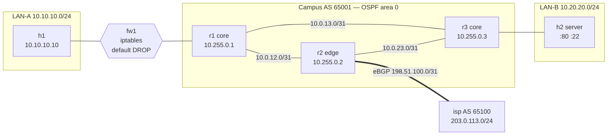

# Network Automation Lab

[](https://github.com/DoctorMen/network-automation-lab/actions/workflows/ci.yml)

**A small enterprise network, defined in one YAML file, built and tested by code.**
Three OSPF core routers, an eBGP uplink to an ISP, a stateful firewall in front of a user LAN, and a server LAN. Every router config, the firewall policy and the lab topology are generated from [`inventory/network.yml`](inventory/network.yml). Then every push to `main`, every pull request and a nightly run deploy the whole network and prove it works: adjacencies come up, routes are where they should be, firewall policy is enforced, traffic survives a link failure (including one where the link stays up and silently drops everything), and no router or firewall has drifted from its intended config.



## What it proves, and the test that proves it

| Behaviour | How it's checked |
|---|---|
| Every core router has Full OSPF adjacencies with exactly the neighbors the inventory says it should | [`test_ospf_adjacencies_are_full`](tests/live/test_routing.py) parses `show ip ospf neighbor json` |
| The eBGP session to the ISP is Established | [`test_bgp_sessions_established`](tests/live/test_routing.py) |
| The ISP only learns the `10.0.0.0/8` aggregate, with no more-specific campus routes leaking out | [`test_isp_sees_only_the_aggregate`](tests/live/test_routing.py) |
| The edge router hands a default route to the core through OSPF | [`test_default_route_reaches_core_via_ospf`](tests/live/test_routing.py) |
| The server LAN is advertised into OSPF, but the router interface facing it is passive, so no OSPF hello reaches a host | [`test_host_lans_are_passive`](tests/live/test_routing.py), for every router interface the inventory puts on a host LAN |
| No routing daemon's management port (vty) answers on a lab link. Every TCP listener on every router is bound to 127.0.0.1, except BGP itself | [`test_router_daemons_listen_on_localhost_only`](tests/live/test_management_plane.py) |
| Users can reach the web server and the internet | [`test_dataplane.py`](tests/live/test_dataplane.py) |
| The firewall blocks SSH from users to servers. The test also proves SSH is actually listening, so the block came from policy, not a dead service | [`test_firewall_blocks_ssh_to_servers`](tests/live/test_dataplane.py) |
| The firewall is stateful: a forged TCP ACK from the server LAN, for a connection no user opened, is dropped instead of being let in as return traffic | [`test_unsolicited_inbound_ack_is_dropped`](tests/live/test_controls.py) forges the packet with a raw socket and reads fw1's exact counters before and after: default drop +1, every allow rule +0 |
| The web rule only lets a connection start: a forged mid-stream ACK to port 80 is dropped, while a real HTTP GET still works | [`test_allow_web_requires_a_handshake`](tests/live/test_controls.py) |
| Anything the rule list doesn't allow is dropped. The test starts a listener on an unlisted port and proves the server's own gateway can reach it, so the block came from policy, not a dead listener | [`test_default_drop_blocks_unlisted_port`](tests/live/test_controls.py) |
| Pulling the r1–r3 link makes OSPF reroute through r2 with no manual action, then fail back | [`test_traffic_survives_r1_r3_link_failure`](tests/live/test_failover.py) |
| Every OSPF link has a BFD session up, with exactly the peers the inventory implies | [`test_bfd_sessions_up`](tests/live/test_failover.py) parses `show bfd peers json` |
| A link that stays up but forwards nothing is routed around in about a second, not after OSPF's 40 s dead timer. h1 still reaches the web server through the stateful firewall, then the path fails back. Measured here: 0.80–1.20 s with BFD, 35.6–39.7 s without | [`test_silent_failure_reroutes_fast`](tests/live/test_failover.py) drops everything on r1's eth2 with iptables, first proves eth2 is still UP, and fails if the route hasn't moved within 3 s, as happens without BFD |
| Nobody changed a router or the firewall by hand. An Ansible playbook backs up every router and the firewall off-box, diffs the running state against intent and fails on any drift. How each device type is collected, and what isn't: [`docs/collection-methods.md`](docs/collection-methods.md) | [`ansible/drift.yml`](ansible/drift.yml) |
| A hand change on a router that was never saved fails one run of that drift check, which names the changed line. The test first proves the check passes on the clean lab | [`test_unsaved_change_is_flagged`](tests/live/test_collection.py) |
| A router backup that is missing part of the running config fails, and the check names the missing line. Each backup is loaded back on its router in test mode; the untouched backup passes | [`test_incomplete_capture_is_flagged`](tests/live/test_collection.py) |
| A rule added by hand on the firewall fails the drift check, which names it. The intended rules are replayed in a separate, empty network namespace, so the check never touches the live rules | [`test_firewall_hand_change_is_flagged`](tests/live/test_collection.py) |
| A hand change saved with `write memory` can't overwrite the intended config and hide from that drift check | [`test_write_memory_cannot_overwrite_intent`](tests/live/test_drift.py) |
| Loss on the carrier link is placed on the carrier from our side alone. `make locate` clears every campus segment in path order, names `r2-isp` and its owner from the inventory, and our edge router sees the loss directly. We never log into the carrier | [`test_carrier_loss_is_placed_on_the_carrier`](tests/live/test_locate.py) |
| Loss on a campus link is named as ours, and from our edge the carrier is clean | [`test_campus_loss_is_not_blamed_on_the_carrier`](tests/live/test_locate.py) |
| A clean path raises no alarm | [`test_clean_path_raises_no_alarm`](tests/live/test_locate.py) |
| `locate` refuses to run on any device the operator doesn't own, loss at a middle hop that doesn't carry on to the destination (ICMP rate limiting) is not called loss, and a hop that didn't answer traceroute is traced again instead of being skipped, which would hand our segment to the carrier | [`tests/test_locate.py`](tests/test_locate.py) |
| The inventory can't ship with duplicate IPs, mismatched subnets, overlapping networks, wrong BGP peer addresses, off-subnet gateways or a device with no owner | [`tests/test_inventory.py`](tests/test_inventory.py), with all problems reported at once |
| Every node runs exactly the image (tag and digest), FRR, Alpine and busybox builds the inventory records, and CI pulls that image | [`test_running_version_matches_inventory`](tests/live/test_platform.py) reads `apk info -v` and `/etc/os-release` on all 7 nodes and `show version` on the 4 routers; [`test_ci_pulls_the_image_the_inventory_names`](tests/test_render.py) |
| Every odd behaviour in the log has one verdict (my config, normal behaviour, platform bug or lab artifact), the version it was seen on, and a fix or workaround. None may stay unclassified past 5 working days | [`docs/verdicts.yml`](docs/verdicts.yml), linted by [`tests/test_verdicts.py`](tests/test_verdicts.py) |
| Every design decision has a record naming the constraint, the alternatives (doing nothing included), an outside source, the stake and who decides | [`docs/decisions/`](docs/decisions/), linted by [`tests/test_decisions.py`](tests/test_decisions.py) |
| The RAM figure below is the newest measurement, and that raw data is committed | [`tests/test_sizing.py`](tests/test_sizing.py) against [`docs/sizing/`](docs/sizing/README.md) |
| Every claim in this table, and every fw1 rule, is in a control register with what it defends against, how it fails, the test that proves it and how often that test must pass | [`docs/controls.yml`](docs/controls.yml), linted by [`tests/test_controls.py`](tests/test_controls.py) |

CI runs every test each night as well as on every push to `main` and every pull request. It keeps the live JUnit results (`results/live.xml`) and config backups as a run artifact for 90 days; the offline tests' results are in the same run's log. That gives every live claim a dated pass or fail; the register says each must pass at least every 31 days.

## Scored against what operators actually need

[OROS 0.3](docs/oros/README.md) is a standard of 61 pass/fail requirements for network and security operations, built from 3,785 relevant Stack Exchange questions and 103 mailing-list, forum and feature-tracker posts. [The scorecard](docs/oros/scorecard.md) holds this lab to every one of them, and names the test behind each pass: **6 pass, 10 partial, 45 fail.** Most of the fails need things a seven-container lab doesn't have yet (a log collector, alerting, per-person accounts), and the scorecard says what each one is missing.

## How it works

```
inventory/network.yml ──► netlab validate ──► netlab render ──► build/
   (source of truth)        (IPAM checks)       (Jinja2)        ├── r1..r3, isp/frr.conf     FRR router configs
                                                                ├── fw1/firewall.sh          iptables policy
                                                                ├── topology.clab.yml        Containerlab topology
                                                                ├── ansible_inventory.yml    Ansible inventory
                                                                └── expected_state.json      what the tests expect
                                     containerlab deploy ──► pytest tests/live ──► ansible drift.yml
```

- **Routers** run [FRRouting](https://frrouting.org/) 8.4.1, the same open-source routing suite used in production by many cloud and ISP networks. Its CLI is close to Cisco IOS. The exact image digest and package versions are in the inventory's `platform:` block, and a live test checks every node against them.
- **The firewall** is a Linux node with an ordered, stateful iptables policy (`ESTABLISHED,RELATED` first, explicit deny, counted default drop) rendered from the rule list in the inventory. TCP allow rules carry `syn: true`, rendered as `--syn`, so only a connection's opening packet can match them and the rest must come through as `ESTABLISHED`. `--ctstate NEW` alone isn't enough: with the kernel default `nf_conntrack_tcp_loose=1`, conntrack picks up a forged mid-stream ACK as a NEW connection. The default drop is counted, not logged: the kernel's LOG target writes nothing from inside a container's network namespace unless the host sets `net.netfilter.nf_log_all_netns=1` ([V-006](docs/verdicts.yml)), so the drop rule's packet counter is the record the tests read.
- **Odd behaviours** each get an entry in [`docs/verdicts.yml`](docs/verdicts.yml): the version, the evidence, one verdict, and the commit that fixed it or the workaround.
- **Ansible** connects to each node through the Docker connection plugin, so no SSH keys are needed in the lab. [`deploy.yml`](ansible/deploy.yml) uses `frr-reload.py` to apply only the lines that differ, without restarting routing daemons, which is how you change a live router safely. `--check` prints the plan without applying it.

## Run it yourself

You need Linux (or WSL2 on Windows) with Docker. The lab is small: measured at 88.5 MiB for all 7 nodes in the `sandbox` environment, a cloud VM where a stand-in replaces Containerlab ([sizing and raw data](docs/sizing/README.md)). No figure from a real Containerlab host is committed yet; every CI run that gets through the drift check measures one and uploads it as the `sizing-data` artifact.

```bash
git clone https://github.com/DoctorMen/network-automation-lab && cd network-automation-lab
python3 -m venv .venv && . .venv/bin/activate
pip install -r requirements.txt -r requirements-ansible.txt
bash -c "$(curl -sL https://get.containerlab.dev)"   # installs Containerlab

make test      # offline: inventory, rendering, locate rules, control register and record lints, scorecard (50 tests)
make deploy    # render configs and start 7 containers
make live      # 26 live tests against the running network, JUnit in results/live.xml
make drift     # back up routers and firewall, fail on drift or an incomplete backup
make measure LAB_ENV=laptop   # RAM per node, saved to docs/sizing/data/
make destroy
```

Poke at it like a real network:

```bash
docker exec -it clab-netauto-r2 vtysh          # then: show ip ospf neighbor / show bgp summary / show ip route
docker exec clab-netauto-h1 ping 10.20.20.10
docker exec clab-netauto-fw1 iptables -vnL FORWARD
```

### Try breaking it

- Change an IP in `inventory/network.yml` so a link's two ends are in different subnets, then run `make validate`.
- Make an undocumented change on a router (`vtysh -c 'conf t' -c 'router ospf' -c 'passive-interface eth2'`) and run `make drift`. It fails and shows the diff. `make apply` puts the router back.
- Open SSH on the firewall by hand (`docker exec clab-netauto-fw1 iptables -I FORWARD -p tcp --dport 22 -j ACCEPT`) and run `make drift`. It fails and names the rule. Delete it with the same command and `-D` instead of `-I`.
- Take a link down (`docker exec clab-netauto-r1 ip link set eth2 down`) and watch `show ip route 10.20.20.0/24` on r1 move to the path through r2.
- Make the same link fail silently: `docker exec clab-netauto-r1 iptables -I INPUT -i eth2 -j DROP`, then the same with `-I OUTPUT -o eth2`. The link stays up, but in about a second BFD declares r3 down, OSPF drops that neighbor (`show ip ospf neighbor`) and the route moves to r2. Run both again with `-D` instead of `-I` to put it back.
- Make the carrier lossy (`docker exec clab-netauto-isp iptables -I INPUT -i eth1 -p icmp -m statistic --mode random --probability 0.2 -j DROP`) and run `make locate SRC=h1 DST=203.0.113.1`. It clears each campus segment, names `r2-isp` and the carrier NOC, and writes the evidence to `build/finding.json`. The same command with `-D` removes the loss. The steps and what to send the carrier are in [`docs/runbooks/carrier-loss.md`](docs/runbooks/carrier-loss.md).
- Forge a mid-stream ACK from the server to a user (`docker exec -i clab-netauto-h2 python3 - 10.10.10.10 20000 80 < tests/live/tools/forge_ack.py`) and watch `default-drop` count it in `docker exec clab-netauto-fw1 iptables -vnxL FORWARD`.
- Change `frr:` in the inventory's `platform:` block to `8.4.2_git-r0`, then run `make render` and `make live`. `test_running_version_matches_inventory` names every node that runs something else.

## Sample output

From a real run:

```
r2# show ip ospf neighbor
Neighbor ID     Pri State           Up Time         Dead Time Address         Interface
10.255.0.1        1 Full/-          40.473s           39.526s 10.0.12.0       eth1:10.0.12.1
10.255.0.3        1 Full/-          35.335s           39.661s 10.0.23.1       eth2:10.0.23.0

isp# show ip bgp
   Network          Next Hop            Metric LocPrf Weight Path
*> 10.0.0.0/8       198.51.100.0             0             0 65001 ?
*> 203.0.113.0/24   0.0.0.0                  0         32768 i
```

## Design decisions

Each decision has a record in [`docs/decisions/`](docs/decisions/) with the constraint behind it, the alternatives (doing nothing included), outside sources, the stake and who decides. `make test` lints them.

- **Point-to-point /31s and `ip ospf network point-to-point`** on router links. No DR/BDR election, faster adjacency (10 s against 40 s for the broadcast default, measured), and half the address space of /30s (RFC 3021). [0001](docs/decisions/0001-p2p-31-links.md)
- **LAN-A sits behind a firewall and is reached by a static route redistributed into OSPF**, not by running OSPF on the firewall. Security devices shouldn't take part in the routing protocol unless they have to. [0002](docs/decisions/0002-static-route-to-lan-a.md)
- **Aggregate at the edge (`summary-only`)**. The ISP sees one stable `/8`, so internal link flaps never reach the internet routing table. [0003](docs/decisions/0003-summary-only-aggregate.md)
- **BFD on every OSPF link, with FRR's default timers** (300 ms, 3 missed packets). OSPF alone needs its 40 s dead timer to notice a link that is up but passes nothing. There is no `bfd` profile, because FRR hides default timer values in `show running-config`, so a profile that spells them out would show as drift forever. Each failure mode of the failover design has a mitigation or an accepted risk in its record. [0009](docs/decisions/0009-failover.md)
- **Server LAN interface is OSPF passive.** The subnet is advertised, but no adjacency can form toward hosts. [0004](docs/decisions/0004-passive-server-lan.md)
- **Intent is mounted read-only.** Each router's `/etc/frr/frr.conf` is its rendered file from `build/`, bind-mounted read-only. With a writable mount, `write memory` after a hand change would save straight into `build/`, and the drift check would then compare the router against its own drifted config and pass. Now `write memory` fails, the change stays only in the running config, and `make drift` catches it. The firewall's `/firewall.sh` is mounted read-only for the same reason. [0008](docs/decisions/0008-read-only-intent.md)
- **Expected state is generated, not hand-written.** The tests read `expected_state.json` from the same inventory that built the configs, so adding a router to the YAML automatically adds it to the tests. [0005](docs/decisions/0005-generated-expected-state.md)
- **Documentation ranges** (`198.51.100.0/24`, `203.0.113.0/24`) for the ISP side, so nothing in the lab collides with real internet addresses (RFC 5737). [0006](docs/decisions/0006-documentation-ranges.md)
- **No management network.** Nodes run with `network-mode: none`. Otherwise Docker's eth0 default route (distance 0) beats the OSPF default and traffic leaves the lab, which is what broke the first CI run. Everything reaches the nodes with `docker exec`. [0007](docs/decisions/0007-no-management-network.md)

## Roadmap

- [ ] VLAN trunk and inter-VLAN routing on a Linux bridge "switch"
- [ ] BGP to a second ISP with local-preference and AS-path prepending for primary/backup
- [ ] IPsec site-to-site VPN between two campuses
- [ ] Batfish pre-deployment analysis of the rendered configs
- [ ] NetFlow/sFlow export into [Guardian SIEM](https://github.com/DoctorMen/Guardian-SIEM-v2.0)
