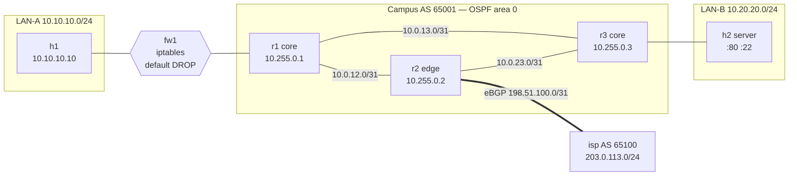

# Network Automation Lab

[](https://github.com/DoctorMen/network-automation-lab/actions/workflows/ci.yml)

**A small enterprise network, defined in one YAML file, built and tested by code.**
Three OSPF core routers, an eBGP uplink to an ISP, a stateful firewall in front of a user LAN, and a server LAN. Every router config, the firewall policy and the lab topology are generated from [`inventory/network.yml`](inventory/network.yml). Then every push to GitHub deploys the whole network and proves it works: adjacencies come up, routes are where they should be, firewall policy is enforced, traffic survives a link failure, and no router has drifted from its intended config.



## What it proves, and the test that proves it

| Behaviour | How it's checked |
|---|---|
| Every core router has Full OSPF adjacencies with exactly the neighbors the inventory says it should | [`test_ospf_adjacencies_are_full`](tests/live/test_routing.py) parses `show ip ospf neighbor json` |
| The eBGP session to the ISP is Established | [`test_bgp_sessions_established`](tests/live/test_routing.py) |
| The ISP only learns the `10.0.0.0/8` aggregate, with no more-specific campus routes leaking out | [`test_isp_sees_only_the_aggregate`](tests/live/test_routing.py) |
| The edge router hands a default route to the core through OSPF | [`test_default_route_reaches_core_via_ospf`](tests/live/test_routing.py) |
| Users can reach the web server and the internet | [`test_dataplane.py`](tests/live/test_dataplane.py) |
| The firewall blocks SSH from users to servers. The test also proves SSH is actually listening, so the block came from policy, not a dead service | [`test_firewall_blocks_ssh_to_servers`](tests/live/test_dataplane.py) |
| Pulling the r1–r3 link makes OSPF reroute through r2 with no manual action, then fail back | [`test_traffic_survives_r1_r3_link_failure`](tests/live/test_failover.py) |
| Nobody changed a router by hand. An Ansible playbook diffs running config against intended config and fails on any drift | [`ansible/drift.yml`](ansible/drift.yml) |
| The inventory can't ship with duplicate IPs, mismatched subnets, overlapping networks, wrong BGP peer addresses or off-subnet gateways | [`tests/test_inventory.py`](tests/test_inventory.py), with all problems reported at once |

## How it works

```
inventory/network.yml ──► netlab validate ──► netlab render ──► build/
   (source of truth)        (IPAM checks)       (Jinja2)        ├── r1..r3, isp/frr.conf     FRR router configs
                                                                ├── fw1/firewall.sh          iptables policy
                                                                ├── topology.clab.yml        Containerlab topology
                                                                ├── ansible_inventory.yml    Ansible inventory
                                                                └── expected_state.json      what the tests expect
                                     containerlab deploy ──► pytest tests/live ──► ansible drift.yml
```

- **Routers** run [FRRouting](https://frrouting.org/) 8.4, the same open-source routing suite used in production by many cloud and ISP networks. Its CLI is close to Cisco IOS.
- **The firewall** is a Linux node with an ordered, stateful iptables policy (`ESTABLISHED,RELATED` first, explicit deny, logged default drop) rendered from the rule list in the inventory.
- **Ansible** connects to each node through the Docker connection plugin, so no SSH keys are needed in the lab. [`deploy.yml`](ansible/deploy.yml) uses `frr-reload.py` to apply only the lines that differ, without restarting routing daemons, which is how you change a live router safely.

## Run it yourself

You need Linux (or WSL2 on Windows) with Docker. The whole lab uses under 100 MB of RAM (measured at 83 MiB for all 7 nodes).

```bash
git clone https://github.com/DoctorMen/network-automation-lab && cd network-automation-lab
python3 -m venv .venv && . .venv/bin/activate
pip install -r requirements.txt -r requirements-ansible.txt
bash -c "$(curl -sL https://get.containerlab.dev)"   # installs Containerlab

make test      # offline: inventory validation + rendering (17 tests)
make deploy    # render configs and start 7 containers
make live      # 11 live tests against the running network
make drift     # Ansible drift check
make destroy
```

Poke at it like a real network:

```bash
docker exec -it clab-netauto-r2 vtysh          # then: show ip ospf neighbor / show bgp summary / show ip route
docker exec clab-netauto-h1 ping 10.20.20.10
docker exec clab-netauto-fw1 iptables -vnL FORWARD
```

### Try breaking it

- Change an IP in `inventory/network.yml` so a link's two ends are in different subnets, then run `make validate`.
- Make an undocumented change on a router (`vtysh -c 'conf t' -c 'router ospf' -c 'passive-interface eth2'`) and run `make drift`. It fails and shows the diff. `make apply` puts the router back.
- Take a link down (`docker exec clab-netauto-r1 ip link set eth2 down`) and watch `show ip route 10.20.20.0/24` on r1 move to the path through r2.

## Sample output

From a real run:

```
r2# show ip ospf neighbor
Neighbor ID     Pri State           Up Time         Dead Time Address         Interface
10.255.0.1        1 Full/-          40.473s           39.526s 10.0.12.0       eth1:10.0.12.1
10.255.0.3        1 Full/-          35.335s           39.661s 10.0.23.1       eth2:10.0.23.0

isp# show ip bgp
   Network          Next Hop            Metric LocPrf Weight Path
*> 10.0.0.0/8       198.51.100.0             0             0 65001 ?
*> 203.0.113.0/24   0.0.0.0                  0         32768 i
```

## Design decisions

- **Point-to-point /31s and `ip ospf network point-to-point`** on router links. No DR/BDR election, faster adjacency, and half the address space of /30s (RFC 3021).
- **LAN-A sits behind a firewall and is reached by a static route redistributed into OSPF**, not by running OSPF on the firewall. Security devices shouldn't take part in the routing protocol unless they have to.
- **Aggregate at the edge (`summary-only`)**. The ISP sees one stable `/8`, so internal link flaps never reach the internet routing table.
- **Server LAN interface is OSPF passive.** The subnet is advertised, but no adjacency can form toward hosts.
- **Expected state is generated, not hand-written.** The tests read `expected_state.json` from the same inventory that built the configs, so adding a router to the YAML automatically adds it to the tests.
- **Documentation ranges** (`198.51.100.0/24`, `203.0.113.0/24`) for the ISP side, so nothing in the lab collides with real internet addresses.

## Roadmap

- [ ] VLAN trunk and inter-VLAN routing on a Linux bridge "switch"
- [ ] BGP to a second ISP with local-preference and AS-path prepending for primary/backup
- [ ] IPsec site-to-site VPN between two campuses
- [ ] Batfish pre-deployment analysis of the rendered configs
- [ ] NetFlow/sFlow export into [Guardian SIEM](https://github.com/DoctorMen/Guardian-SIEM-v2.0)
